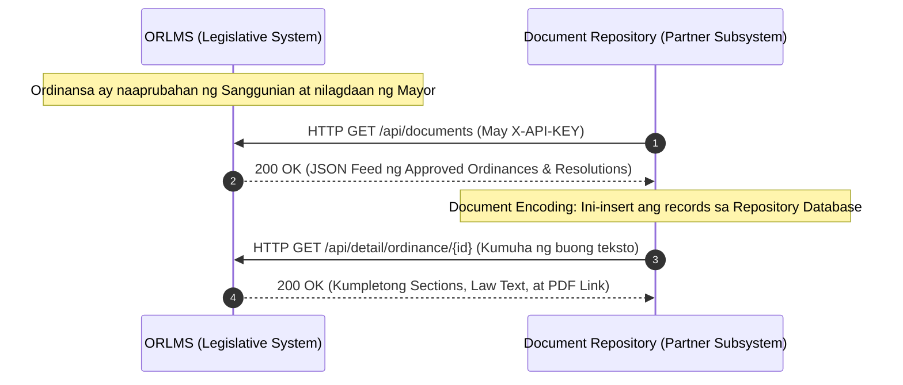

# 🔌 ORLMS Integration API Specification Guide
**Sistema:** Ordinance and Resolution Lifecycle Management System (CSJDM, Bulacan)  
**Dokumento:** Partner Subsystem REST API Contract & Integration Manual  
**Target Subsystem:** Document Repository & Archiving Subsystem (Document Encoding Module)  
**Format:** RESTful JSON  
**Base URL (Live):** `https://portal-orlms-sjdm.hostforgeplatforms.com`  
**Base URL (Local):** `http://localhost:8000`

---

## 🏛️ 1. Arkitektura at Daloy ng Integrasyon (Architecture Flow)

Ang **ORLMS** ang opisyal na sistema ng Sangguniang Panlungsod para sa paggawa, pagsusuri, at pagpapatibay ng mga lokal na batas.

Kapag ang isang Ordinansa o Resolusyon ay umabot na sa opisyal na estado ng pagpapatupad (**`approved`**, **`signed_lce`**, **`enacted`**, o **`published`**), awtomatiko itong inilalabas ng **`Legislative Publication & Integration API Module`** upang mahatak at mai-encode ng inyong **Document Repository**:



---

## 🔑 2. Authentication & Headers

Lahat ng requests mula sa inyong subsystem ay dapat may kasamang HTTP Headers:

| Header | Value | Deskripsyon |
| :--- | :--- | :--- |
| `Accept` | `application/json` | Format ng datos na tatanggapin |
| `X-API-KEY` | `ORLMS-PARTNER-API-KEY-2026` | Inyong itinalagang Subsystem API Key |

*(Maaari ring ipasa bilang query parameter kung GET request: `?api_key=ORLMS-PARTNER-API-KEY-2026`).*

---

## 📡 3. Available Endpoints

### 🟢 Endpoint 1: Kunin ang Lahat ng Approved Documents (Unified Feed)
Ito ang **pangunahing endpoint** na kailangan ng inyong Document Encoding module para mahatak nang sabay ang mga naaprubahang ordinansa at resolusyon.

* **Method:** `GET`
* **Route:** `/api/documents`
* **Query Parameters (Optional):**
  * `limit` (Default: `50`, Max: `100`)
  * `full` (Set sa `1` kung nais isama agad ang buong legal text)

#### Sample JSON Response:
```json
{
  "status": "success",
  "feed": "approved_legislative_repository",
  "count": 2,
  "timestamp": "2026-10-10 23:55:00",
  "data": [
    {
      "document_type": "ordinance",
      "id": 19,
      "document_no": "ORD-2026-0019",
      "title": "An Ordinance Institutionalizing the CSJDM Clean Air and Anti-Smoke Belching Program",
      "subject": "Environmental Protection and Public Health",
      "status": "signed_lce",
      "ai_summary": "Inaatasan ang City Environment Office na magpatupad ng random roadside emission testing at nagpapataw ng multa sa mga lalabag.",
      "file_path": "uploads/documents/ORD-2026-0019.pdf",
      "download_url": "https://portal-orlms-sjdm.hostforgeplatforms.com/public/uploads/documents/ORD-2026-0019.pdf",
      "date_filed": "2026-09-15",
      "created_at": "2026-09-26 14:30:00",
      "committee_name": "Committee on Health, Sanitation, and Environment",
      "author_name": "Hon. Ronald Llamo"
    },
    {
      "document_type": "resolution",
      "id": 13,
      "document_no": "RES-2026-0013",
      "title": "A Resolution Commending the San Jose del Monte National High School Robotics Team",
      "subject": "Commendation and Education Excellence",
      "status": "approved",
      "ai_summary": "Paggawad ng pagkilala at insentibo sa mga mag-aaral na nagwagi sa International STEM Competition.",
      "file_path": null,
      "download_url": null,
      "date_filed": "2026-09-20",
      "created_at": "2026-09-25 10:15:00",
      "committee_name": "Committee on Education, Youth, and Sports Development",
      "author_name": "Hon. Maria Santos"
    }
  ]
}
```

---

### 🟢 Endpoint 2: Kunin ang mga Approved Ordinances Lamang
* **Method:** `GET`
* **Route:** `/api/ordinances`
* **Query Parameters:** `?limit=50&full=1`

### 🟢 Endpoint 3: Kunin ang mga Approved Resolutions Lamang
* **Method:** `GET`
* **Route:** `/api/resolutions`
* **Query Parameters:** `?limit=50&full=1`

---

### 🟢 Endpoint 4: Kumuha ng Buong Detalye ng Isang Batas (Full Text & Sections)
Gamitin ito kung nais i-download o i-encode ang buong katawan (text) ng batas sa inyong repository.

* **Method:** `GET`
* **Route:** `/api/detail/{type}/{id}`
* **Halimbawa:** `/api/detail/ordinance/19` o `/api/detail/resolution/13`

#### Sample JSON Response:
```json
{
  "status": "success",
  "data": {
    "id": 19,
    "document_type": "ordinance",
    "ordinance_no": "ORD-2026-0019",
    "title": "An Ordinance Institutionalizing the CSJDM Clean Air Program",
    "subject": "Environmental Protection",
    "content": "SECTION 1. TITLE. This ordinance shall be known as...\n\nSECTION 2. SCOPE...\n\nSECTION 3. PENALTIES...",
    "status": "signed_lce",
    "ai_summary": "Buod ng batas para sa mabilis na paghahanap...",
    "download_url": "https://portal-orlms-sjdm.hostforgeplatforms.com/public/uploads/documents/ORD-2026-0019.pdf",
    "committee_name": "Committee on Environment",
    "author_name": "Hon. Ronald Llamo"
  }
}
```

---

## 💻 4. Sample Code para sa Tropa Mo (Copy-Paste Ready)

### A. Gamit ang PHP (cURL):
```php
<?php
$apiUrl = 'https://portal-orlms-sjdm.hostforgeplatforms.com/api/documents';
$apiKey = 'ORLMS-PARTNER-API-KEY-2026';

$ch = curl_init($apiUrl);
curl_setopt_array($ch, [
    CURLOPT_RETURNTRANSFER => true,
    CURLOPT_HTTPHEADER     => [
        'Accept: application/json',
        'X-API-KEY: ' . $apiKey
    ],
    CURLOPT_TIMEOUT        => 10,
    CURLOPT_SSL_VERIFYPEER => false
]);

$response = curl_exec($ch);
$httpCode = curl_getinfo($ch, CURLINFO_HTTP_CODE);
curl_close($ch);

if ($httpCode === 200) {
    $result = json_decode($response, true);
    $documents = $result['data'];
    
    // I-loop at i-save sa sarili ninyong Document Repository Database:
    foreach ($documents as $doc) {
        echo "Na-encode: [" . $doc['document_type'] . "] " . $doc['document_no'] . " - " . $doc['title'] . "\n";
        // TODO: INSERT INTO your_repository_table (...) VALUES (...)
    }
} else {
    echo "Error fetching from ORLMS. HTTP Code: " . $httpCode;
}
```

### B. Gamit ang JavaScript (Fetch API / Node.js):
```javascript
async function fetchApprovedDocumentsFromORLMS() {
  const url = 'https://portal-orlms-sjdm.hostforgeplatforms.com/api/documents';
  const apiKey = 'ORLMS-PARTNER-API-KEY-2026';

  try {
    const res = await fetch(url, {
      method: 'GET',
      headers: {
        'Accept': 'application/json',
        'X-API-KEY': apiKey
      }
    });

    const data = await res.json();
    console.log(`Natanggap na mga aprubadong batas: ${data.count}`);
    
    // Ipasok sa repository state / UI
    return data.data;
  } catch (error) {
    console.error('Failed to connect to ORLMS API:', error);
  }
}
```

---

## 📋 5. Data Mapping Matrix para sa Inyong Database

Ito ang pagtutugma ng fields mula sa ORLMS patungo sa inyong Repository Database:

| Field mula sa ORLMS API | Uri ng Datos | Gamit sa Repository ng Tropa Mo |
| :--- | :--- | :--- |
| `document_type` | String (`ordinance` / `resolution`) | Kategorya ng dokumento |
| `document_no` | String (hal. `ORD-2026-0019`) | Tracking / Reference Code sa repository |
| `title` | String | Pamagat ng batas |
| `subject` | String | Paksa / Classification Tag |
| `status` | String (`enacted`, `signed_lce`, etc.) | Legislative validity status |
| `ai_summary` | String | Maikling buod para sa search index |
| `content` | Text / LongText | Buong katawan ng batas |
| `download_url` | String (URL) | Link para ma-download ang orihinal na PDF |
| `committee_name` | String | Komiteng may hawak |
| `author_name` | String | May-akda / Kagawad na nagpanukala |
