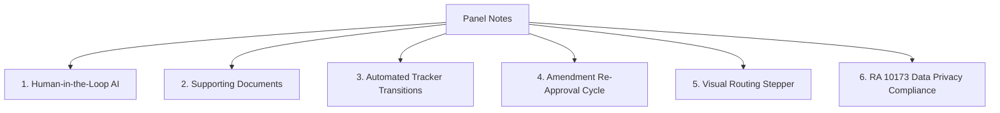

# ORLMS — Capstone Defense Major Revisions Action Plan
**Sistema:** Ordinance and Resolution Lifecycle Management System (CSJDM, Bulacan)  
**Dokumento:** Post-Defense Major Revision Blueprint & Implementation Roadmap  
**Petsa:** Oktubre 10, 2026  
**Status ng Defense:** PASSED (with Major Revisions)

---

## 📌 1. Buod ng Revisions mula sa Panel

Batay sa mga tala ng panel habang isinasagawa ang oral defense, mayroong **anim (6) na pangunahing aspeto** na kailangang i-upgrade sa sistema at sa documentation bago ang pinal na pagsusumite (Hardbound / Final Sign-off):



---

## 🏛️ 2. Detalyadong Plano sa Bawat Puna ng Panel

### 🧩 Pillar 1: Human-in-the-Loop AI Validation (AI-Assisted, Human-Decided)
* **Puna ng Panel:** *"Walang human intervention / Nag-rely sa AI / Kailangan ng validation na gagamitin bago mag-approved"*
* **Prinsipyo:** Sa pamahalaan at batas ng LGU, ang AI ay hindi maaaring maging tagahatol o awtomatikong mag-approve o mag-reject ng batas. Ang AI ay **Advisory Tool** lamang.
* **Plano ng Pagpapatupad:**
  1. **AI Recommendation Disclaimer:** Malinaw na imarkang *"AI Recommendation & Compliance Audit (Advisory Only)"* ang output ng Groq/Qwen.
  2. **Official Human Sign-Off Form:** Bago makarating ang ordinansa sa Approval phase, ang nakatalagang **Legislative Staff** o **Legal Committee Reviewer** ay kailangang:
     * Maglagay ng opisyal na Reviewer Notes o Findings.
     * Mag-check ng confirmation box: `[x] I have verified the AI analysis against local policies and certify this draft.`
     * Pindutin ang *"Certify & Endorse Draft"* — ito ang magiging opisyal na tulay patungo sa Sanggunian approval.

---

### 📎 Pillar 2: Mandatory Supporting Documents & Attachments
* **Puna ng Panel:** *"Dapat may supporting document"*
* **Prinsipyo:** Ayon sa Internal Rules ng Sanggunian, ang anumang ordinansa ay dapat may mga kalakip na opisyal na katibayan bago isalang sa First Reading o Committee Review.
* **Plano ng Pagpapatupad:**
  1. **Dynamic Attachment Categories sa Drafting Phase:**
     * *Committee Report* (PDF/DOCX)
     * *Minutes of Public Hearing / Consultation*
     * *Certificate of Availability of Funds* (para sa Appropriation/Budget ordinances)
     * *Endorsement Letter mula sa Punong Lungsod o Barangay*
  2. **Attachment Verification Badge:**
     * Sa bawat document detail view, magpapakita ng listahan ng mga kalakip na dokumento na may direct download/preview link at file hash para sa verification.
     * Hindi papayagang ma-endorse para sa approval kung kulang ang mga kinakailangang supporting documents batay sa kategorya ng ordinansa.

---

### ⚙️ Pillar 3: Automated Milestone-Driven Status Transitions
* **Puna ng Panel:** *"Dapat automatic na based sa tracker / Iwas na mag-manual / Mas maganda na automatic at hindi manual"*
* **Prinsipyo:** Iwasan ang manu-manong pagpili ng status gamit ang dropdown (hal. paglipat mula `draft` patungong `approved`). Dapat magbago ang status base sa aktwal na natapos na hakbang sa tracker.
* **Plano ng Pagpapatupad:**
  1. **Lifecycle Event Triggers:**
     * Pagkatapos mag-upload ng draft at supporting documents ➔ Awtomatikong magiging `submitted`.
     * Kapag naglagda ang Committee Chairman sa review ➔ Awtomatikong magiging `endorsed_for_reading`.
     * Kapag nag-input ng voting results ang SP Secretary ➔ Awtomatikong magiging `approved_sp` o `tabled`.
     * Kapag nag-upload ng signed executive copy ang Mayor's Office ➔ Awtomatikong magiging `enacted`.
     * Kapag nakumpleto ang post-enactment publication proof ➔ Awtomatikong magiging `published`.
  2. Tanggalin ang mga manual dropdown selector ng status sa admin forms upang maiwasan ang human error at tampering.

---

### 🔄 Pillar 4: Amendment Re-Approval Lifecycle (RA 7160 Compliance)
* **Puna ng Panel:** *"Pag nag-amend - dapat mabalik sa approval"*
* **Prinsipyo:** Sa ilalim ng Section 54 ng Republic Act 7160 (Local Government Code), kapag ang isang naaprubahang ordinansa ay binago, ang binagong bersyon ay dapat dumaan muli sa approval ng Sanggunian.
* **Plano ng Pagpapatupad:**
  1. **Amendment Submission Flow:**
     * Sa `AmendmentsController.php`, kapag may nagsumite ng bagong amendment para sa isang batas:
     * Awtomatikong ililipat ang status ng ordinansa mula `approved` / `enacted` pabalik sa `for_reapproval` o `under_amendment_review`.
  2. **Diff / Side-by-Side Comparison:**
     * Magpapakita ng visual diff (orihinal na teksto vs. iminungkahing bagong teksto) para malinaw sa mga miyembro ng Sanggunian kung anong seksyon ang binago.
  3. **Re-Approval Vote Tracking:**
     * Kinakailangan muli ng opisyal na sesyon o botohan bago muling maibalik ang ordinansa sa estado ng pagpapatupad.

---

### 🗺️ Pillar 5: Visual Document Routing Stepper & Accountability Timeline
* **Puna ng Panel:** *"Flow makita - Kung sino-sino ang involved, kung sino ang nag-approved"*
* **Prinsipyo:** Transparent governance at kumpletong traceability ng bawat kawani na humawak sa dokumento.
* **Plano ng Pagpapatupad:**
  1. **Interactive Routing Timeline (Stepper UI):**
     * Ilalagay sa tuktok ng bawat ordinance/resolution view:
     ```text
     [1. Author] ────► [2. Legislative Review] ────► [3. Committee Hearing] ────► [4. SP Plenary] ────► [5. Mayor's Approval] ────► [6. Public Enactment]
       (Kagawad)            (Staff Specialist)             (Chairman)                 (Vice Mayor)             (City Mayor)                 (Published)
     ```
  2. **Sign-Off Metadata Cards:**
     * Sa bawat yugto ng stepper, makikita:
       * Pangalan at Posisyon ng humawak
       * Araw at eksaktong oras (Timestamp)
       * Aksyong isinagawa (Endorsed, Signed, Approved)
       * Remarks o komento

---

### 🛡️ Pillar 6: Data Privacy Act of 2012 (RA 10173 Compliance)
* **Puna ng Panel:** *"Data privacy / Republic Act"*
* **Prinsipyo:** Protektahan ang personally identifiable information (PII) ng mga lumalagda, mamamayan, at kawani.
* **Plano ng Pagpapatupad:**
  1. **Public vs. Internal View Filtering:**
     * Sa Public Portal, awtomatikong itatago o ima-mask ang pribadong data (personal mobile numbers, personal home addresses, signature images na walang watermark).
  2. **Public Citizen Verification Disclaimers:**
     * Pagsasaayos ng Data Privacy Notice sa lahat ng public search, citizen inquiries, at public consultation portals.
  3. **Role-Based Access Guardrails:**
     * Ang buong unmasked routing history ay maaari lamang ma-access ng mga awtorisadong kawani ng Sanggunian gamit ang kanilang 2FA OTP account.

---

## 🚀 3. Phase-by-Phase Execution Roadmap

| Phase | Saklaw ng Gawain | Target Deliverables |
| :--- | :--- | :--- |
| **Phase 1** | **Database Schema Updates** | Magdagdag ng tables/columns para sa: <br>• `supporting_documents`<br>• `document_routing_steps`<br>• `amendment_history`<br>• `human_certifications` |
| **Phase 2** | **Workflow & Lifecycle Automations** | • Alisin ang manual status dropdowns.<br>• Ipatupad ang automated milestone triggers.<br>• I-link ang Amendment flow pabalik sa `for_reapproval`. |
| **Phase 3** | **Human-in-the-Loop & Supporting Docs UI** | • Form para sa Human AI Certification.<br>• Upload at preview module para sa attachments.<br>• Document category compliance checklist. |
| **Phase 4** | **Visual Stepper & Data Privacy Polish** | • Interactive Visual Routing Stepper.<br>• RA 10173 PII masking sa Public Portal.<br>• Defense documentation writeup (Chapters 3 & 4 updates). |

---

## 📝 4. Gabay para sa Thesis Manuscript (Chapter Revisions)

Kapag natapos natin ang coding nito, ito ang mga partikular na seksyon sa inyong thesis manuscript na madali nating maidadagdag:
* **Chapter 3 (Methodology & System Architecture):**
  * I-update ang Activity Diagrams at State Machine Diagrams para ipakita ang *Milestone-driven automated state transitions* at ang *Amendment Re-Approval Loop*.
  * Idagdag ang Data Privacy Compliance Matrix (RA 10173).
* **Chapter 4 (Results & Discussion):**
  * Ipakita ang screenshots ng Visual Routing Timeline at Human Certification form.
  * I-present ang comparative table ng *AI-Generated Recommendations vs. Human Legislative Decision*.
* **Chapter 5 (Summary & Recommendations):**
  * Isama bilang future enhancement o post-defense resolution ang mas pinatibay na integration sa mga digital signature ng LGU.

---

> [!NOTE]
> Nakatala at naka-save na ang buong planong ito. Kapag handa ka na sa susunod na araw pre, sabihan mo lang ako at sisimulan natin sa **Phase 1 (Database schema at supporting models)** nang tuloy-tuloy at walang hassle!
